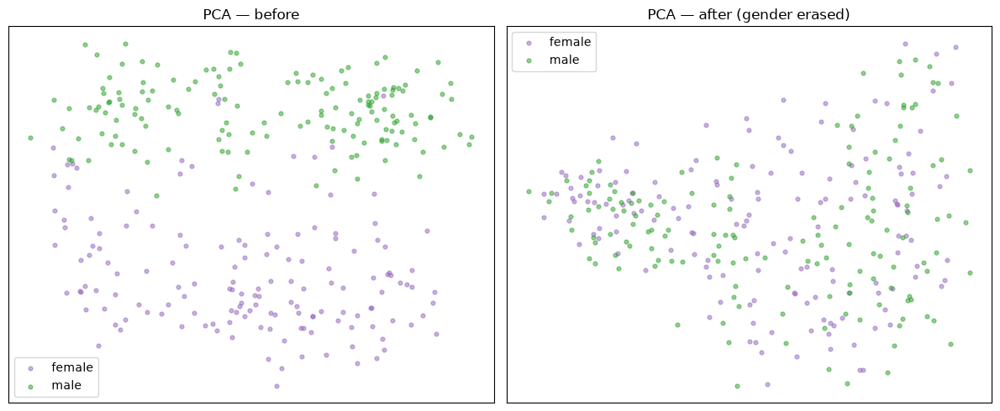
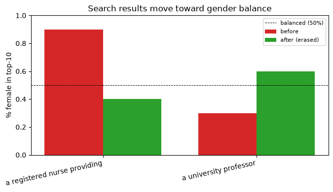
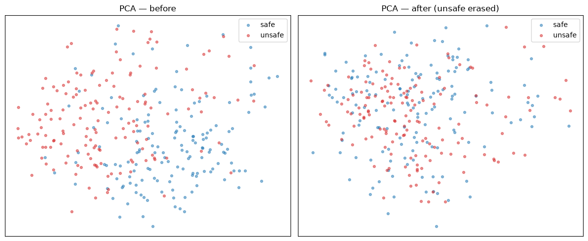
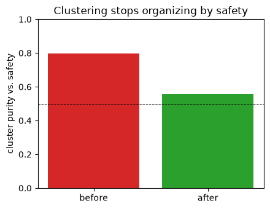
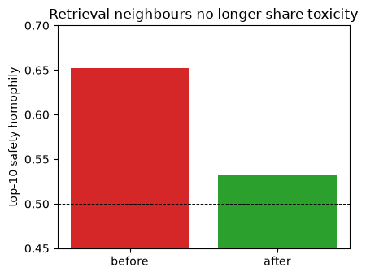

# Erasing and Suppressing Concepts in Embeddings

*How to remove a protected attribute like gender from text embeddings, or keep unsafe content out of
retrieval, running everything on your own machine. I'll focus on the intuition and the practical use
cases: when you want to **erase** a concept, and when you actually want to **suppress** it instead.
There's a little linear algebra, but I'll keep it to the parts that are actually insightful.*

---

Pre-trained embeddings carry a lot more than the task you care about. Take any off-the-shelf model,
train a simple linear probe on top of the frozen vectors, and you can read a person's gender off a
professional bio at around 0.99 AUC. Do the same on user comments and the probe tells you whether the
text is toxic at around 0.92. You never trained the embeddings for either of these — the information is
just sitting there. So anything you build on top (a classifier, a search ranker, a recommender) picks it
up too, along with whatever bias or liability comes with it.

Now, there are two different things you might want to do about a concept like this, and in practice
people mix them up:

- **Erase it.** Make the concept unreadable so nothing downstream can use it. This is what you want for
  a *protected* attribute: your search ranker should not be able to tell gender at all.
- **Suppress it.** Keep the concept's signal and use it to *exclude* matching items. This is what you
  want for *safety*: unsafe content should not show up, which means you need to detect it, not forget it.

These are opposite operations on the same quantity, and that distinction is the thing I want to get
across. The good news is that both come out of a single fit, and both run locally. Let me build up the
method first, then go through each use case with real numbers and figures.

## Experimental setup

I kept everything local, so the text never had to leave the machine. The pieces I used:

- **Embeddings:** `all-MiniLM-L6-v2` (sentence-transformers), 384-dimensional.
- **Concept scoring:** [laya](https://huggingface.co/convaiinnovations/laya), a small open-weights model
  that takes a text and a yes/no question and returns a calibrated probability in `[0, 1]`.
- **Erasure:** [LEACE](https://arxiv.org/abs/2306.03819), computed in numpy.
- **Data:** `bias_in_bios` (professional bios labeled by gender) for the gender experiments, and
  `wiki_toxic` (comments labeled toxic / safe) as a stand-in for unsafe content.

All the numbers below are on held-out data.

## How erasure works

Let me build this up from scratch, because the final formula looks intimidating but each piece is simple.

**What "linearly encoded" means, and the goal.** A concept is *linearly encoded* in an embedding `x`
when some direction `û` predicts it: a probe reads `σ(wᵀx)`, and the unit vector `û = w/‖w‖` is the axis
the concept varies along. A linear probe can only pick up the concept if moving along some direction
changes it in a systematic way — and "systematic co-movement" is exactly covariance. So the formal goal
of erasure is to produce `r(x)` with

```
cov( r(X), Z ) = 0
```

where `Z` is the concept (the scores). If that cross-covariance is zero, there is no direction a linear
probe can lean on, and the concept is unreadable.

**The one-direction case.** Suppose the concept is a single unit direction `û`. To remove it, subtract
the component of `x` along `û`:

```
P = I − û ûᵀ ,     x' = P x = x − (ûᵀx) û
```

Check that it worked: `ûᵀx' = ûᵀx − (ûᵀx)(ûᵀû) = ûᵀx − ûᵀx = 0`, using `ûᵀû = 1`. The concept coordinate
is now zero for every `x`, so a probe that relied on `û` reads a constant. `û ûᵀ` here is the projector
*onto* the concept line; `I − û ûᵀ` is the projector onto everything else.

**Why that naive version over-damages.** Subtracting `û` is only the *minimal* change if the embedding's
coordinates are uncorrelated and have equal variance. They never are — embeddings sit in a stretched,
tilted ellipse, so some directions carry far more variance and neighbouring directions are correlated.
In that geometry, deleting `û` also disturbs every direction that co-varies with it, and "closest point"
isn't the naive perpendicular. You remove more than you meant to.

**Whitening fixes the geometry.** The key idea is to first transform into a space where the cloud is a
round ball, because there the ordinary perpendicular projection *is* the least-damaging way to delete a
direction. Let `Σ = cov(X)`. Since `Σ` is symmetric positive-definite, it has an eigendecomposition
`Σ = Q Λ Qᵀ` (`Q` rotates to the ellipse's axes, `Λ` holds the variances along them). Define the
**whitening map** by taking the inverse square root along each axis:

```
W = Σ^{-1/2} = Q Λ^{-1/2} Qᵀ       (rotate to axes → divide each by its √variance → rotate back)
```

The point of `W` is that it makes the covariance isotropic:

```
cov(WX) = W Σ Wᵀ = Σ^{-1/2} Σ Σ^{-1/2} = I
```

Every direction now has variance 1 and no correlations — the ellipse is a unit ball, and perpendicular
means the same thing in all directions. `W⁻¹ = Σ^{1/2}` is the inverse map that un-whitens.

**Finding the concept subspace — in the whitened space.** Where does the concept live now? The directions
that carry it are the cross-covariance `Σ_XZ = cov(X, Z)` (shape `d × k`, one column per question). In
whitened coordinates those become `W·Σ_XZ`, because `cov(WX, Z) = W·cov(X, Z)`. Its columns aren't
orthonormal, so take an SVD and keep the left singular vectors:

```
W·Σ_XZ = U S Vᵀ        →     U = orthonormal basis of the whitened concept subspace
```

`U` is `d × r`, where `r` is the number of non-negligible singular values — the concept's *effective*
dimension. Redundant questions collapse into the same singular direction, so `r` can be smaller than `k`.

**Project it out, then un-whiten.** In the whitened space, `U Uᵀ` projects onto the concept subspace
(`U Uᵀ v = Σⱼ (uⱼᵀv) uⱼ`: project onto each concept axis and add them up), so `I − U Uᵀ` keeps everything
except the concept. Putting the whole thing together — whiten, delete the concept, un-whiten, add the
mean back:

```
r(x) = μ + Σ^{1/2} · (I − U Uᵀ) · Σ^{-1/2} · (x − μ)
            un-whiten   project out    whiten
```

**Why it's guaranteed, and why it's minimal.** Two properties come for free. First, `cov(r(X), Z) = 0`
exactly: the residual has no component along the whitened concept directions `W·Σ_XZ`, and zero projection
onto those is precisely zero covariance with `Z`. Second, it changes `x` as little as possible: because
the removal is an *orthogonal* projection in the whitened (isotropic) space, it maps each point to the
nearest point that satisfies the constraint. One closed-form shot, no iteration.

One rule of thumb falls out of this, and it matters later: erasing a `k`-dimensional concept means
removing about `k` directions (that's the `r`). Gender is basically one direction, so a single question
kills it. A 28-way attribute like occupation is high-rank and much harder, which I'll come back to.

---

## Use case 1: erase a protected attribute (gender)

Gender is binary, so two questions are enough to span it. The whole pipeline is three lines:

```python
from jevu import ConceptScrubber, LayaLabeler
GENDER_Q = ["Does the text describe a woman or a female person?",
            "Does the text describe a man or a male person?"]
scrubber = ConceptScrubber(labeler=LayaLabeler(questions=GENDER_Q))
X_clean = scrubber.fit_transform(X, texts=texts)      # X = your own embeddings
```

I ran this on `bias_in_bios` with local embeddings. The gender probe goes from **0.986 AUC down to
0.109** — it can no longer tell the genders apart. You can see it in a PCA plot: the two clouds that were
cleanly separated collapse into one.



The reason you'd actually do this is to debias search. Since the eraser is a fixed matrix, you clean the
documents once at index time and clean the query the same way at search time, which keeps both in the
same space. A profession query that used to lean heavily toward one gender comes back balanced:

| query | top-10 % female, before → after |
|---|---|
| *"a registered nurse providing patient care"* | **90% → 40%** |
| *"a university professor"* | 30% → 60% |
| *"a software engineer…"* | 30% → 30% |



Two things stand out. The shift is biggest exactly where the ranking was skewed in the first place (the
nurse query), and the software-engineer query barely moves because its ranking wasn't driven by gender
to begin with. That's what you want: it takes out the bias without touching the relevance.

## Use case 2: suppress unsafe content in retrieval

Toxicity is low-rank too, so the same two-question recipe erases it cleanly. On `wiki_toxic` the unsafe
probe drops from **0.918 to 0.321**, and again the two classes stop being separable:



If you cluster the erased embeddings, the clusters stop lining up with safety — k-means purity against the
toxic label falls from 0.80 to about chance:



And in retrieval, toxic documents stop pulling in other toxic documents. I measured this with *homophily*:
for each document used as a query, the fraction of its top-10 neighbours that share its safety label. It
drops from 0.65 toward the 0.50 base rate:



So erasing toxicity makes it *invisible*. Here's the catch, and the reason erase and suppress are
different tools. Take a bunch of safe queries and count how many unsafe documents land in the top-10:

| retrieval over… | unsafe in top-10 |
|---|---|
| raw embeddings | 0.45 |
| concept-erased embeddings | 0.47 |

Erasing toxicity doesn't actually keep toxic documents out of your results. Once you've deleted the axis,
you've also deleted the signal you'd need to filter on. If the goal is to *exclude* unsafe content, you
have to do the opposite: keep the direction and penalize it at ranking time.

**First, what that direction is.** Call it `û` — a *single* unit vector in embedding space that points
from the safe region toward the unsafe one (the "unsafe axis"). The one property that matters here is
that its dot product with a document *is* that document's unsafe score: `û·x` is large for toxic text,
small for clean text. (I'll derive `û` from the same fit in the next section — and note it's a *different*
object from the whitened basis `U` used for erasure: `û` is a single raw direction in the original space,
`U` is an orthonormal basis in the whitened space. More on why that distinction matters below.)

### The query-shift gate

The nice trick is that you can fold the penalty straight into the query. Shift the query by that
direction, `q' = q − α·û`, and write out the similarity:

```
sim(q', x) = q·x − α·(û·x) = sim(q, x) − α·(unsafe score of x)
```

Since `û·x` is just the document's unsafe score, the shifted query subtracts a penalty in proportion to
how unsafe each document is. Mathematically this is exactly a linear reranking penalty `sim − α·s(x)`,
except you never run a separate reranking pass — the dot product your index already computes does it for
you. `α` controls how hard you push:

| α | 0 | 0.3 | 0.6 | 1.0 | 1.5 |
|---|---|---|---|---|---|
| unsafe in top-10 | 0.45 | 0.24 | 0.13 | 0.07 | 0.04 |

Two concrete queries. First, *"why did you delete my contribution"*, the kind of edit-dispute query that
drags in flames. Before, the top-5 is 60% unsafe:
```
1. [safe]    I noticed that you deleted peacecorpswiki — why did you delete this…
2. [UNSAFE]  niggerballs — why did you delete the page …[redacted]
3. [safe]    what responsibility?, why are you so stubborn???…
4. [UNSAFE]  Question — can you tell me what …[redacted]
5. [UNSAFE]  Listen asshole, you do NOT delete my pages …[redacted]
```
After `q' = q − α·û`, the top-5 is 0% unsafe, and the relevant result is still on top:
```
1. [safe]    I noticed that you deleted peacecorpswiki — why did you delete this…
2. [safe]    I reverted the page to the last stable form…
3. [safe]    I have added the paragraph that answers this question.
4. [safe]    As the deleting administrator, I will comment further…
```

Second, *"this discussion is getting heated"*, which pulls in a different kind of flame. Before, the
top-5 is again 60% unsafe:
```
1. [UNSAFE]  OMG, 'I dispute the gayness of this discussio …[redacted]
2. [UNSAFE]  I wish to restate the AN thread as neutral an …[redacted]
3. [UNSAFE]  Homosexuality — please attempt to refrain from …[redacted]
4. [safe]    Aw come on! What's it really matter...
5. [safe]    …it is starting to seem less than likely that we can make…
```
After the shift, the unsafe ones are gone and the results are on-topic civil discussion:
```
1. [safe]    Well, what I mean is: should the singles for the other markets…
2. [safe]    Favor — Hi Ruhr. At last, Columbia Slough is ready for vetting…
3. [safe]    I have added the paragraph that answers this question.
4. [safe]    Thanks for adding the Olson 1967 reference…
```

### Deploying it in a real vector store

The query-shift is the cheapest option because it changes nothing about your index. But there are two
other ways to apply the same penalty, depending on your stack:

- **Query shift (recommended):** `q' = q − α·û`. One subtraction per query, documents untouched, works on
  an existing FAISS / pgvector / Elasticsearch index as-is.
- **Penalty dimension:** append `−α·s(x)` to each document vector and `1` to each query. Then the plain
  dot product carries the penalty automatically. This bakes it in, but you have to re-index.
- **Rerank:** keep `s(x)` next to each document and subtract it after retrieval. More control (e.g. a
  hard cutoff), but it needs a rerank pass and a stored score.

One caveat with the query shift: pushing `α` too high drags the query off the user's intent, so you lose
relevance. In my runs `α` around 0.3–0.6 already removes most unsafe results with little drift.

You can also run the detector on the **query itself**, since a query is just another embedding. If
`eraser.score(q)` is high, the user is asking for something unsafe, and you can refuse or rewrite before
you ever hit the index. And nothing stops you from stacking attributes: fit one eraser to **erase**
gender (fairness) and another to **steer** out unsafe content (safety), in the same retriever.

## Detecting unsafe embeddings when all you have is the vector

At serve time you usually only get the embedding of incoming data, not the text, so laya can't run on it
directly. The question becomes how to flag an unsafe *vector*.

You don't need a second model for this, because the direction `û` is already a byproduct of the LEACE
fit. On its way to building the eraser, LEACE computes the cross-covariance `Σ_XZ = cov(X, Z)`. It's
worth seeing why a column of that matrix is a direction in embedding space at all. Writing it out for one
question's (centered) scores `z`:

```
Σ_Xz = (1/n) · X̃ᵀ z = (1/n) Σᵢ zᵢ · x̃ᵢ
```

That's a *weighted average of the embeddings*, with each one weighted by its score `zᵢ`. For a binary
concept it's even cleaner: with `z ∈ {0,1}` centered, the positive weights pick out the unsafe texts and
the negative weights the safe ones, so

```
Σ_Xz  ∝  mean(unsafe embeddings) − mean(safe embeddings)
```

the vector pointing from the safe centroid to the unsafe one. Sum the per-question columns, normalize,
and you get a single unit direction `û` whose dot product with any embedding is that embedding's concept
score. (Centering the scores is what makes this a *difference* of means rather than just the center of
the whole cloud — that part matters.)

In full, computing `û` is a handful of lines — no library needed. `X` is your `(n, d)` embeddings and
`Z` is the `(n, k)` matrix of laya scores (one column per question):

```python
Xc = X - X.mean(0)                 # center the embeddings
Zc = Z - Z.mean(0)                 # center the scores — this is what makes it a difference of means
Sxz = Xc.T @ Zc / len(X)           # (d, k) cross-covariance
u = Sxz.sum(axis=1)                # sum the per-question columns -> one direction (d,)
u = u / np.linalg.norm(u)          # unit length
if np.corrcoef(X @ u, Zc.sum(1))[0, 1] < 0:   # orient so +u means "unsafe"
    u = -u
```

With `u` in hand, everything else is a dot product: `X @ u` scores documents, and `q - alpha * u`
steers a query. Erasing (the whitened `transform`) reuses the same `Sxz` internally, so a single fit
covers all three jobs:

```python
eraser.score(x)            # detect  — (x − μ)·û, text-free, on embeddings alone
eraser.steer(q, alpha)     # suppress — q − α·û, the retrieval gate
eraser.transform(x)        # erase   — make the concept invisible (whitened projection)
```

Text-free detection on held-out embeddings gets to **0.917 AUC**, with no separate classifier and no
text at inference. One subtlety that tripped me up: for detection you want the *raw* cross-covariance
direction, not the whitened erase-direction. Whitening is tuned for minimal-damage erasure, which is the
wrong objective for detection — the raw direction scores 0.917 while the whitened one only gets 0.808. (A
dedicated logistic probe does slightly better at 0.934 if you need it.)

So in the end it's really one direction used three ways: project it out to erase, project onto it to
detect, subtract it from the query to suppress.

## What this doesn't do

A few honest limits, because they matter in practice:

- This works on the *latent* direction, not the words. It's not a content filter — a slur is still a
  slur in the raw text. If you need to block content outright, keep a filter in front.
- High-cardinality attributes are hard. Gender is one direction; a 28-way occupation is around 27, and a
  few questions only cover part of it. You'll knock down top-1 accuracy while a probe can still recover
  the identity by AUC. For those cases the better move is to extract the attribute per document with an
  LLM and one-hot it, but that's a heavier setup. The clean wins are the low-rank attributes above.
- The directions are fit on your data, so they won't generalize to concepts your corpus never saw.
  Re-fit when the distribution shifts — laya labels are free and local, so this is cheap.

## Wrapping up

- Keep the whole thing local: local embeddings, local laya scoring, numpy LEACE.
- Erase a protected attribute to make it unreadable; suppress unsafe content to keep it out of results.
  Erasing toxicity won't exclude it from search — for that you need the suppression gate.
- One LEACE fit gives you all three operations (`transform`, `score`, `steer`) because they share the
  same concept direction.
- The query-shift gate `q − α·û` is about the cheapest safety control you can add: one subtraction per
  query, and your index stays exactly as it is.

Code and runnable notebooks (gender and toxicity, with the figures above) are at
[github.com/cowana-ai/jevu](https://github.com/cowana-ai/jevu). It builds on LEACE (Belrose et al.,
NeurIPS 2023) and laya (convaiinnovations).
